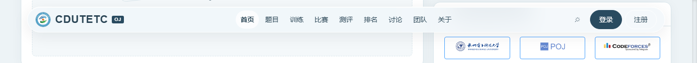
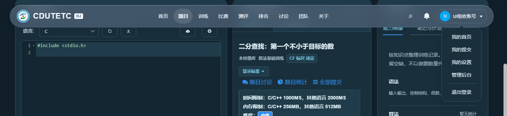
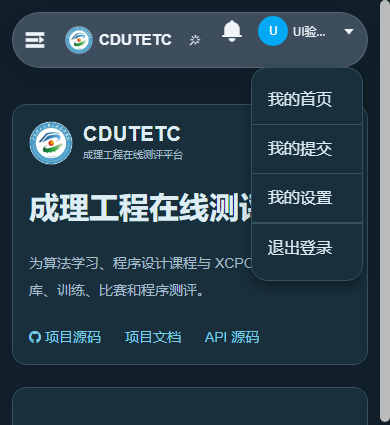
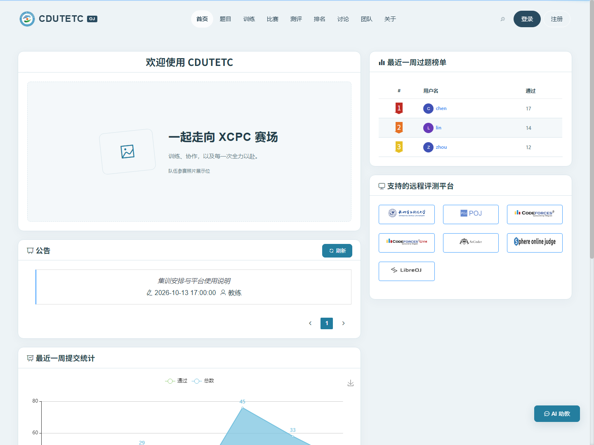
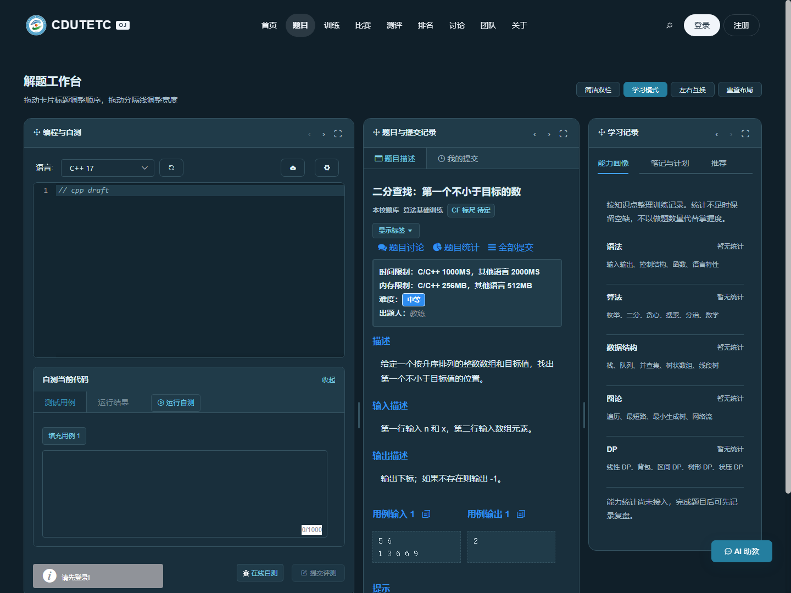
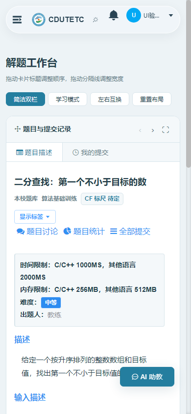

# UI 验收截图

2026-10-14，Chrome 隔离浏览器，桌面 1440 × 1080 / 手机 390 × 844。页面运行的是本仓库 Vue 源码；接口数据由 `tests/browser-review.cjs` 拦截生成。截图中的题目、用户、排行榜为测试数据，不是线上成绩。

执行结果见 [browser-review.json](browser-review.json)，`validated=true`，无未捕获异常。运行方式与验证边界见 [前端 README](../README.md) 和 [实现记录](../UI-IMPLEMENTATION.md)。

## 悬浮玻璃导航：滚动后的浅色 / 深色状态

九个入口始终保留，滚动后收拢，鼠标或键盘进入时展开。校徽保留原色，右侧是界面外观和登录/注册。

## 登录后的头像菜单

管理员菜单显示“管理后台”，普通用户隐藏该项。打开菜单时导航保持舒展。

## 首页：原内容与 XCPC 照片展示位

## 深色工作台：调整过顺序与宽度，自测留在编程卡片

## 同一题目页的填空作答区：判分服务待接入

## 手机题目页

