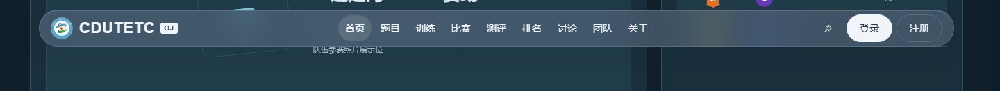
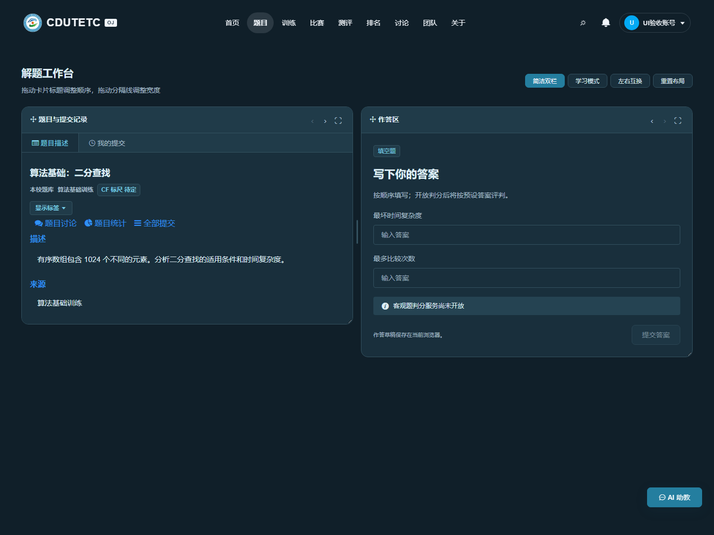

# UI 验收截图

## 2026-10-15 收拢导航缩小与悬浮按钮分隔

滚动后的胶囊进一步缩窄、降低高度，并收紧校徽、字号和操作间距；鼠标移入仍展开。1440px 登录态实测约 **1000×50px**（此前 1100×56px），1920px 下宽度上限为 1120px。九个主入口保留，触屏继续使用较大的点击区域。

| 项目 | 浅色 | 深色 |
| --- | --- | --- |
| 滚动收拢 | [查看](compact-nav-light.png) | [查看](compact-nav-dark.png) |
| 鼠标移入展开 | [查看](expanded-nav-light.png) | [查看](expanded-nav-dark.png) |
| AI 助教与返回顶部 | [桌面](floating-1440-light.png) / [手机](floating-390-light.png) | [桌面](floating-1440-dark.png) / [手机](floating-390-dark.png) |

重叠源于原返回顶部按钮和 AI 入口分别使用了相近的固定底部位置。现将返回顶部放在距底部 24px、右侧 24px 处，AI 入口与默认弹窗放在上方，间隔 16px；弹窗宽高也为视口留出边距。

[本轮检查结果](compact-navigation-review.json)：实际本地 Vue 页面、隔离浏览器、模拟接口，`validated=true`，未捕获异常 0。覆盖访客 / 登录态 × 深浅主题 × 1920、1440、1280、1200、1024、992、390px 共 28 组布局，检查九个入口与品牌 / 操作区不重叠、悬停展开、AI 打开关闭及返回顶部真实点击。桌面与手机四组悬浮按钮间距均为 16px。未新增运行时依赖或监听；本次小改通过热更新页面验证，未重跑生产构建。待用户视觉验收，未暂存或提交 Git。

## 2026-10-15 头像外观面板与比赛简化

本地入口为 **http://localhost:8080/home**。通知旁的太阳 / 月亮按钮直接触发主题扩散；登录后从「头像 → 主题与布局」切换标准 / 简洁模式、导航、柔光、首页玻璃、菜单变形、间距和动画。访客保留外观按钮。若电脑开启减少动态效果，选择「完整动画」可开启本站过渡。

| 观察点 | 截图 |
| --- | --- |
| 快捷按钮发起的主题过渡 | [查看](appearance-theme-shortcut-wave.png) |
| 深色个人菜单与外观设置 | [菜单](appearance-profile-dark.png) / [设置](appearance-settings-dark.png) |
| 首页玻璃与原有内容 | [浅色](appearance-home-glass-light.png) / [深色](appearance-home-glass-dark.png) |
| 简洁模式与比赛自动简化 | [首页](appearance-minimal.png) / [比赛](appearance-contest-minimal.png) |
| 手机导航对齐与设置面板 | [查看](appearance-settings-mobile.png) |

[外观专项结果](appearance-review.json) 与 [完整公共页回归](appearance-regression.json) 均 `validated=true`，未捕获异常 0。完整回归使用隔离 Chrome 和固定模拟接口，覆盖九个导航入口、普通用户 / 管理员菜单、五页双主题卡片、工作台、代码草稿及原自测 / 提交流程；不向真实后台写入。另运行 [真实访客动效专项](motion-review.json)，未替换接口响应，结果通过。生产构建通过，22 项 UI 数据契约检查通过。

外观专项检查了实际主题按钮的扩散原点、菜单变形、开关生效与刷新保留、比赛自动简化和退出恢复（不改保存的偏好）、关闭自动简化、手机边界、监听清理及 4 倍 CPU 降速下的功能。主题、菜单与柔光操作新增 API 请求数为 0；静止 800ms 采样没有新布局，柔光停止更新，反复开关菜单没有增加文档监听。采样仅说明这次浏览器检查的结果，不代表 GPU 帧率或 400 用户容量。

性能范围：没有新增动效依赖或图片下载，装饰不执行持续逐帧循环；首页模糊 / 折射限定小范围，手机与粗指针关闭。默认进入带比赛 ID 的页面（含补题）自动使用简洁模式，离开恢复，也可由用户关闭。300–400 人同时访问仍需使用生产构建验证静态资源、带宽、接口和数据库容量；开发环境热更新不能证明生产容量。用户视觉验收待完成，未暂存或提交 Git。

## 2026-10-15 本机减少动画偏好与站内覆盖

最新 [motion-review.json](motion-review.json) 访问 `http://localhost:8080`，先保留本机真实媒体偏好：系统请求减少动画，默认导航过渡为 0 秒；通过外观面板实际选择「完整动画」后，主题动画恢复为 1400ms，导航恢复 620ms，刷新后仍保留。另检查显式减少动画、跟随系统实时变化、原双向过渡、导航和各断点，`validated=true`，未捕获异常 0。使用隔离访客会话，不修改用户日常浏览器的设置或后台数据。

入口截图：[动画效果设置](motion-full-settings.png)。默认跟随系统，在本站选择完整动画即可预览，不需要重建 Docker 镜像。下方动效截图也已随本次专项更新；原公共页模拟接口回归报告来自上一轮，未以它代替本轮真实环境检查。用户视觉验收待完成，未暂存或提交 Git。

## 2026-10-15 导航明显收拢与主题抛物线过渡

真实本地服务、隔离 Chrome 访客会话，未替换接口响应。见 [motion-review.json](motion-review.json)：双向抛物线过渡从所点选项中心出发，连续请求、键盘、跟随系统、减少动画及浏览器回退、导航收拢/悬停/聚焦和桌面/手机/触屏横屏均通过，`validated=true`，未捕获异常 0。1440px 窗口下导航从 1430×80 收至 1100×56；临时条纹的像素检查确认透明导航模糊了下方内容，检查后移除临时元素。原生实现没有新增运行时依赖。

| 观察点 | 截图 |
| --- | --- |
| 浅色切深色的抛物线过渡中间帧 | [查看](theme-reveal-to-dark.png) |
| 深色切浅色的抛物线过渡中间帧 | [查看](theme-reveal-to-light.png) |
| 滚动收拢 / 鼠标进入展开 | [收拢](nav-motion-condensed.png) / [展开](nav-motion-expanded.png) |
| 手机深色外观面板 | [查看](theme-mobile-dark.png) |

中间帧按实际过渡速度截取：主题扫过 1400ms，导航缓动 620ms，未放慢浏览器播放。原有 [公共页与工作台回归](motion-regression.json) 也通过（该报告采用模拟接口，`validated=true`，异常 0），覆盖九个导航入口、角色菜单、工作台和公共页双主题布局；保留原有 Vue Router / vxe tooltip 等提示。生产构建通过；用户视觉验收待完成，未暂存或提交 Git。

## 2026-10-15 主要按钮随主题切换

实际本地开发服务、隔离 Chrome 访客会话，未替换接口响应。刷新、开始练习和 AI 助教在浅色使用蓝底白字，深色使用浅蓝底深色文字；同时检查悬停、按下、键盘聚焦和 AI 发送禁用态。结果见 [button-theme-review.json](button-theme-review.json)：`validated=true`，未捕获异常 0；可操作按钮各状态最小文字对比度浅色 4.73:1、深色 6.25:1。

| 页面 | 浅色 | 深色 |
| --- | --- | --- |
| 首页三个主要入口 | [查看](buttons-home-light.png) | [查看](buttons-home-dark.png) |

原开始练习跳转、测评刷新、AI 小窗打开通过；快速离开题库的延迟回调清理后，原切换路径复查通过。未执行答题提交、重判或业务保存。生产构建通过，待用户视觉验收，未暂存或提交 Git。

## 2026-10-15 管理端主题与加载页

本节运行实际本地开发服务 `http://127.0.0.1:8080`，使用隔离 Chrome 浏览器真实登录管理员。与下面的公共页模拟数据回归不同，本节未替换接口响应。结果见 [admin-theme-review.json](admin-theme-review.json)：`validated=true`，未捕获异常 0，没有触发业务写入。原有桌面登录、用户编辑弹窗、日期选择器、手机菜单及返回前台时清除管理主题作用域均通过。

| 项目 | 浅色 | 深色 |
| --- | --- | --- |
| 管理端完整配色 | [查看](admin-user-light.png) | [查看](admin-user-dark.png) |
| 编辑器输入区 / 预览 / 工具栏 | [查看](admin-editor-light.png) | [查看](admin-editor-dark.png) |
| 通知说明 | [查看](admin-notice-light.png) | [查看](admin-notice-dark.png) |
| 开关开启 / 关闭状态 | [查看](admin-switch-light.png) | [查看](admin-switch-dark.png) |
| 原色校徽加载页 | [查看](loader-light.png) | [查看](loader-dark.png) |

另有 [深色日期选择器](admin-datepicker-dark.png)、[手机管理页](admin-mobile-dark.png)。桌面 1440 × 1080，手机 390 × 844。加载页通过暂停外部脚本检查真实 HTML 启动状态，验证显式深浅色、跟随系统及减少动态效果；解除暂停后可正常进入页面，加载层被移除。

边界：截图中的编辑器文案、部分开关状态仅在测试浏览器表单中临时设置，未保存至后台。训练创建页因现有数据库没有分类，保留原“先创建分类”提示；验证了编辑器配色及该提示，未绕过前置条件。没有执行题目、训练、比赛创建/保存、账号变更或判题回归。生产构建通过，仍有原列表样式 `start` 兼容提示及 Browserslist 数据提示。用户视觉验收待完成，未进行 Git 暂存或提交。

## 2026-10-14 公共页与工作台

2026-10-14，Chrome 隔离浏览器，桌面 1440 × 1080 / 手机 390 × 844（首页另有全页截图）。页面运行的是本仓库 Vue 源码；接口数据由 `tests/browser-review.cjs` 与 `tests/collection-fixtures.cjs` 拦截生成。截图中的题目、用户、排行榜为测试数据，不是线上成绩。

执行结果见 [browser-review.json](browser-review.json)，`validated=true`，无未捕获异常。运行方式与验证边界见 [前端 README](../README.md) 和 [实现记录](../UI-IMPLEMENTATION.md)。

## 五页卡片布局

下载后在浏览器打开 [可切换截图预览](cards-preview.html)，选择页面、浅色/深色、桌面/手机。它仅展示截图；真实页面需要运行前端和后端。

| 页面 | 浅色桌面 | 深色桌面 | 浅色手机 | 深色手机 |
| --- | --- | --- | --- | --- |
| 首页 | [全页](source-cards-home-light-full.png) | [全页](source-cards-home-dark-full.png) | [查看](source-cards-home-light-390.png) | [查看](source-cards-home-dark-390.png) |
| 训练 | [查看](source-cards-training-light-1440.png) | [查看](source-cards-training-dark-1440.png) | [查看](source-cards-training-light-390.png) | [查看](source-cards-training-dark-390.png) |
| 比赛 | [查看](source-cards-contest-light-1440.png) | [查看](source-cards-contest-dark-1440.png) | [查看](source-cards-contest-light-390.png) | [查看](source-cards-contest-dark-390.png) |
| 讨论 | [查看](source-cards-discussion-light-1440.png) | [查看](source-cards-discussion-dark-1440.png) | [查看](source-cards-discussion-light-390.png) | [查看](source-cards-discussion-dark-390.png) |
| 团队 | [查看](source-cards-group-light-1440.png) | [查看](source-cards-group-dark-1440.png) | [查看](source-cards-group-light-390.png) | [查看](source-cards-group-dark-390.png) |

结构化结果中的 `checks.collections` 记录 20 组页面/主题/尺寸、900px 平板双列、长标题和分类、卡片底部主题一致性、分页与筛选、空结果、失败重试等结果。另验证访客点击需登录、原团队创建对话框可打开。原有导航、角色菜单、工作台等回归仍执行。浏览器保留原 vxe tooltip 和 Vue Router 废弃属性提示，没有分页类型警告；这些检查不等于真实后端联调或用户验收。

## 悬浮玻璃导航：滚动后的浅色 / 深色状态

九个入口始终保留，滚动后收拢，鼠标或键盘进入时展开。校徽保留原色，右侧是界面外观和登录/注册。

## 登录后的头像菜单

管理员菜单显示“管理后台”，普通用户隐藏该项。打开菜单时导航保持舒展。

## 首页：原内容与 XCPC 照片展示位

## 深色工作台：调整过顺序与宽度，自测留在编程卡片

## 同一题目页的填空作答区：判分服务待接入

## 手机题目页

